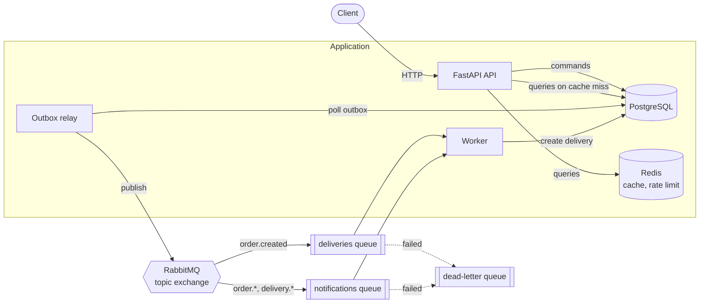

# DeliveryHub

[](https://github.com/aleksandranesterovich9-bit/deliveryHub/actions/workflows/ci.yml)


A food delivery backend: customers order from restaurants, a background worker
creates deliveries from events, and admins move each delivery through its lifecycle.

It is a small, fully async service built the way production services usually are:
CQRS, a transactional outbox with RabbitMQ, Redis caching, migrations, tests on real
Postgres in CI, and a one-command Docker setup.

📚 A detailed walkthrough with experiments and exercises (in Russian): [docs/how-it-works.ru.md](docs/how-it-works.ru.md)

## Architecture



**Order flow:**

1. `POST /orders` saves the order **and** an `order.created` event to the `outbox` table in a single transaction.
2. The **relay** picks up unpublished outbox rows and publishes them to RabbitMQ.
3. The **worker** consumes `order.created`, creates a `pending` delivery, and sends a notification.
4. An admin moves the delivery `pending → courier_assigned → in_transit → delivered`; each step emits `delivery.status_changed`, and `delivered` completes the order.

## Design decisions

| Decision | Why |
|---|---|
| **CQRS**: `application/commands` and `application/queries` | Writes enforce business rules and emit events. Reads are simple, cacheable, and return DTOs. Routers stay thin. |
| **Transactional outbox** | Avoids the dual-write problem: an order can never be saved without its event (or the other way round). Orders are still accepted while RabbitMQ is down, and events go out once it is back. |
| **At-least-once + idempotent consumers** | The relay may publish an event twice, so the worker checks whether the delivery already exists, with a `UNIQUE(order_id)` constraint as the final guard. |
| **Dead-letter queue** | A message that fails processing is parked in `delivery_hub.dead_letters` for inspection instead of being retried forever. |
| **Versioned cache keys** | Any restaurant write bumps `restaurants:version`, which invalidates every cached list and item at once. No `KEYS`/`SCAN`, and TTL cleans up old keys. |
| **Graceful degradation** | If Redis is down, the cache becomes a miss and the rate limiter fails open. The API keeps working, and `/health` reports `degraded`. |
| **Login rate limiting** | After `LOGIN_MAX_ATTEMPTS` failures, a phone number is blocked for `LOGIN_BLOCK_SECONDS` (HTTP 429 + `Retry-After`). |
| **Delivery state machine** | Allowed status transitions live in one table in `domain/statuses.py` and are unit tested. |
| **Business errors ≠ HTTP errors** | Handlers raise `NotFoundError`/`ConflictError`/…, and the API layer maps them to status codes. |

## Tech stack

Python 3.13 · FastAPI · Pydantic v2 · SQLAlchemy 2 (async) + asyncpg · PostgreSQL 17 ·
Alembic · Redis · RabbitMQ (aio-pika) · JWT + Argon2 · pytest · Ruff · Docker Compose · GitHub Actions

## Quick start

```bash
docker compose up --build
```

| What | Where |
|---|---|
| Swagger UI | http://localhost:8000/docs |
| RabbitMQ management | http://localhost:15672 (guest / guest) |
| Postgres | `localhost:5433` (postgres / postgres) |

Migrations and demo data (restaurants and an admin) are applied automatically by the `migrate` service.
Demo admin: phone `+70000000000`, password `admin12345` (configurable via `ADMIN_PHONE` / `ADMIN_PASSWORD`).

### Try it

```bash
# register and log in as a customer
curl -X POST localhost:8000/auth/register -H 'Content-Type: application/json' \
  -d '{"name": "Alex", "phone": "+79991234567", "password": "password123"}'
TOKEN=$(curl -s -X POST localhost:8000/auth/login -d 'username=%2B79991234567&password=password123' | jq -r .access_token)

# place an order
curl -X POST localhost:8000/orders -H "Authorization: Bearer $TOKEN" -H 'Content-Type: application/json' \
  -d '{"restaurant_id": 1, "dish": "Margherita", "quantity": 2, "delivery_address": "Lenina 1, apt. 5"}'

# a second later the worker has created the delivery
curl localhost:8000/orders/1 -H "Authorization: Bearer $TOKEN"

# watch the events flow
docker compose logs -f relay worker
```

## API

| Method | Path | Access | |
|---|---|---|---|
| POST | `/auth/register` | public | Register a customer |
| POST | `/auth/login` | public | OAuth2 password flow (phone as username), rate limited |
| GET | `/auth/me` | user | Current user |
| GET | `/restaurants` | public | List with `name` search and pagination (cached) |
| GET | `/restaurants/{id}` | public | One restaurant (cached) |
| POST/PUT/DELETE | `/restaurants[/{id}]` | admin | Manage restaurants |
| POST | `/orders` | user | Place an order → `order.created` |
| GET | `/orders` | user | Own orders (admins see all), filters: `restaurant_id`, `order_status` |
| GET | `/orders/{id}` | owner/admin | Order with its delivery |
| POST | `/orders/{id}/cancel` | owner/admin | Cancel while the courier has not picked it up → `order.cancelled` |
| GET | `/deliveries` | admin | Deliveries, filter: `delivery_status` |
| PATCH | `/deliveries/{id}/status` | admin | Next lifecycle step → `delivery.status_changed` |
| GET | `/health` | public | Database and Redis status |

## Project structure

```
app/
├── api/              # HTTP layer: routers, dependencies, error mapping
├── application/
│   ├── commands/     # write side: change state, stage events
│   └── queries/      # read side: return DTOs, use the cache
├── domain/           # statuses, state machine, integration events
├── db/               # SQLAlchemy models and session
├── infrastructure/   # Redis cache, rate limiter, RabbitMQ, outbox relay
├── schemas/          # Pydantic request/response models
├── worker/           # RabbitMQ consumers       (python -m app.worker)
├── relay.py          # outbox → RabbitMQ         (python -m app.relay)
└── scripts/seed.py   # demo data
migrations/           # Alembic
tests/                # 57 tests: API, worker, outbox, domain
```

## Development

```bash
python -m venv .venv && .venv\Scripts\activate      # Windows (Linux/macOS: source .venv/bin/activate)
pip install -r requirements-dev.txt

pytest                          # SQLite in memory + fakeredis, no Docker needed
ruff check . && ruff format .   # lint and format

# run the app locally against infrastructure in Docker
cp .env.example .env
docker compose up -d postgres redis rabbitmq
alembic upgrade head && python -m app.scripts.seed
uvicorn app.main:app --reload   # plus `python -m app.relay` and `python -m app.worker` in other terminals
```

New migration after changing models: `alembic revision --autogenerate -m "what changed"`.

CI runs lint, the test suite against **real PostgreSQL**, checks that the migrations match the models (`alembic check`), and builds the Docker image.

## Roadmap

- Restaurant menus and orders with several items
- Courier role: couriers take orders and update the status themselves
- Real-time order status for clients (WebSocket / SSE)
- Retries with backoff before a message goes to the dead-letter queue
- Observability: structured logs, request IDs, Prometheus metrics
